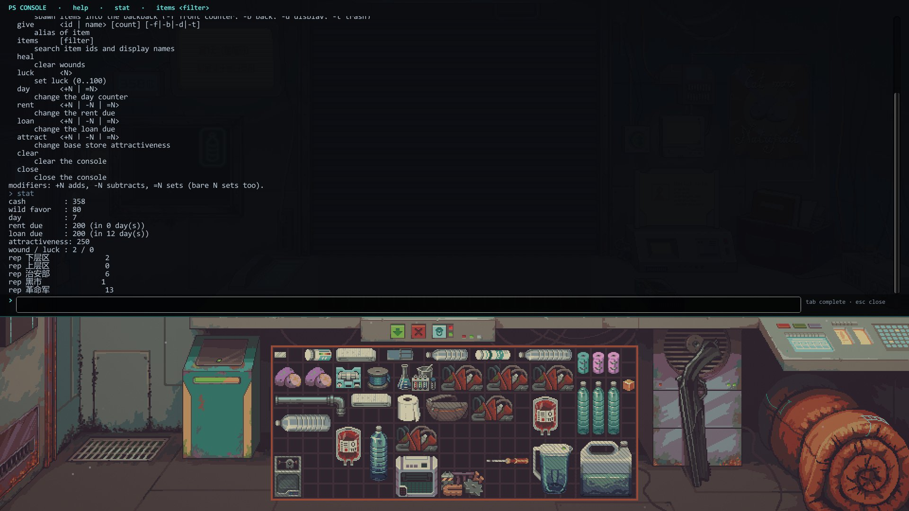
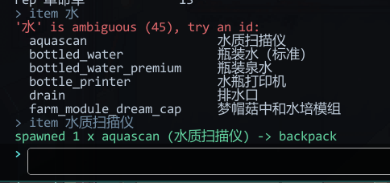

# PS Console

[English](README.en.md) · **简体中文**

《Probably Stolen》的游戏内控制台。按 `~` 打开，敲命令刷物品、改数值。

基于游戏**原生 mod 框架**（`Mods/<id>/manifest.xml` + DLL），不需要 BepInEx / MelonLoader / dev.txt。



```
> item 水
'水' is ambiguous (45), try an id:
  aquascan                    水质扫描仪
  bottled_water               瓶装水（标准）
  bottled_water_premium       瓶装泉水
  bottle_printer              水瓶打印机
  drain                       排水口
  farm_module_dream_cap       梦帽菇中和水培模组
> item 水质扫描仪
spawned 1 x aquascan (水质扫描仪) -> backpack
```



## 安装

直接下 [Releases](../../releases/latest) 里的 `ps-console-1.1.0.zip`，里面就是可用的 `ps_console` 文件夹。

1. 把 `ps_console` 文件夹放进 `Probably Stolen/Mods/`。
2. 启动游戏 → 主菜单 **Mods** → 选中 **PS Console** → **Activate**。
3. **重启游戏**（新激活的 mod 下次启动才加载）。
4. 进入存档后按 `~`（键盘上没有反引号就按 `F10`）。

> 第一次激活时游戏会扫 DLL、比对 manifest 声明的能力。本 mod 不读文件、不联网、不反射外部程序集，`<Capabilities />` 留空即可通过。

## 命令

| 命令 | 说明 |
| --- | --- |
| `help [命令]` | 列出全部命令 / 看某条用法 |
| `stat` | 现金、Wild 好感、天数、租金、贷款、吸引力、伤势/幸运、各派系声望 |
| `cash +500` / `cash -200` / `cash =1000` | 加 / 减 / 设为指定金额 |
| `favor +10` | Wild 的好感 |
| `rep` / `rep list` | 列当前派系声望 |
| `rep security +50` | 单个派系加减 |
| `rep all =100` | 所有派系（游戏自己 clamp 到 -200..200） |
| `item <id 或名字> [数量] [-f\|-b\|-d\|-t]` | 刷物品；`-f` 前台柜台、`-b` 后仓、`-d` 展示柜、`-t` 垃圾桶，默认背包 |
| `give …` | `item` 的别名 |
| `items [关键词]` | 搜物品，id 和显示名一起匹配，结果两列对照 |
| `heal` | 清伤势 |
| `luck 80` | 设幸运值 0–100 |
| `day +1` | 改天数计数器（可能打乱排期事件） |
| `rent -200` / `loan -200` | 改租金 / 贷款 |
| `attract +100` | 改店铺基础吸引力 |
| `clear` / `close` | 清屏 / 关窗 |

**数值写法**：`+N` 加、`-N` 减、`=N` 设为 N、裸写 `N` 也是设为 N。

**派系简写**：`lower` `upper` `security`(`sec`) `blackmarket`(`bm`) `revolution`(`rev`) `tourist` `church` `cartel`。

**快捷键**：`Tab` 补全（命令名 / 物品 id）、`↑↓` 翻历史、`Esc` 关闭、`Enter` 执行。

### 按名字搜物品

不记得 id 没关系，`items` 和 `item` 都同时匹配 **id、英文名、游戏内中文名**：

```
items 水        → 把带"水"的物品全列出来（id + 显示名两列）
item 水          → 命中多个时不会瞎猜，直接把候选列出来让你挑
item 水质扫描仪  → 唯一命中，直接刷 1 个进背包
```

## 几个实现要点

- **只压键盘，不动鼠标**：两个 Harmony postfix 让游戏以为在打字（`StoreUIManager.IsAnyTyping`、`KeyBindHelper.get_SuppressHotkeys`）；
  面板区域挂一个独立 Canvas + 透明 Image 吃掉点击，防止点输入框时顺带抓到柜台上的货，面板以外的点击照常传给游戏。
- **物品 id ↔ 显示名**：名字不是从 id 拼的（`bandage_item` → `item_bandage_name`），先查本地化表，
  查不到就临时造一个物品读 `GetDisplayName()` 再 `Destroy()`，按 id 缓存；搜索只走便宜路径，不会一次造上千个物品。
- **manifest 不写 `<GameVersions>`**：这版游戏报不出可用版本串，写了任何条目都会被标红；留空显示 `-` 且不报错。

## 从源码编译

需要 .NET SDK（6.0+）和一份游戏本体。

```bash
cd src/PSConsole
dotnet build -c Release -p:GameDir="C:\Program Files (x86)\Steam\steamapps\common\Probably Stolen"
```

`GameDir` 也可以用环境变量 `PS_GAME_DIR`，默认走标准 Steam 路径。编译成功会自动把
`PSConsole.dll` + `manifest.xml` 拷进 `<GameDir>/Mods/ps_console/`。

DLL 每次重新编译都会变，游戏会要求 **Review and enable** —— 在 mod 详情页打开一次 **Developer mode**，之后自动信任。

### 目录结构

```
src/PSConsole/
├── ModEntry.cs          IMod 入口；创建 DontDestroyOnLoad 的控制台对象
├── ConsoleBehaviour.cs  IMGUI 窗口：输入、历史、补全、滚动、开关
├── CommandProcessor.cs  命令注册、参数解析、Tab 补全
├── Commands.cs          各命令实现 + 物品数据库
└── Patches.cs           两个 Harmony postfix
```

loader 会自己 `PatchAll`，所以 mod 里**不要**再调一次。

## 注意

- `cash` / `rep` 改的是**当前存档内存里的值**，要保存才落盘。
- `day` 直接改计数器，可能与事件/租金排期错位，先存档。
- 控制台不暂停游戏，打开时时间照常走。
- 物品名会跟随游戏语言（表里有条目的部分），没条目的回落到英文 id。
- 仅针对 **100-Rev6** 测过；游戏更新若改掉被 patch 的方法名，mod 会加载失败（看日志、提 issue）。
- 和 Questing Goose Studio 无关，仓库不含任何游戏文件。

## 同类 mod

只是想要功能、不想自己编译的话：

- [Debug Console Plus](https://www.nexusmods.com/probablystolen/mods/257) — ButterLab，`Ctrl+Shift+I`，功能最全（UI 面板、物品属性、NPC、事件）
- [PSConsole](https://www.nexusmods.com/probablystolen/mods/554) — muchengbai，`/`
- [Console Mod](https://www.nexusmods.com/probablystolen/mods/618) — BBQ886，`~`

## 许可

MIT，见 [LICENSE](LICENSE)。
